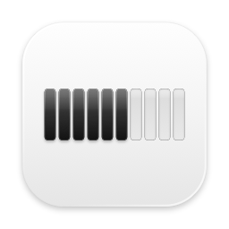
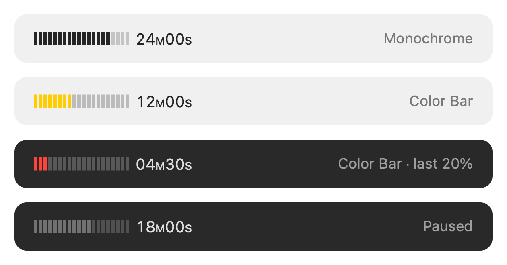

<p align="center">
  
</p>

<h1 align="center">Lapso</h1>

<p align="center"><em>a slice of time in your menu bar.</em></p>

<p align="center">
  
</p>

Lapso is a tiny countdown timer that lives in the macOS menu bar. It shows the time left as a 20-segment bar, so you can tell how much is left at a glance without reading numbers.

## Features

- **Bar + time.** A 20-segment bar and the remaining time, written as `24M00S` so it is never mistaken for a clock.
- **One click to start.** Click to start a 30-minute timer. Click again to pause or resume. When the timer is idle or at `00M00S`, a click starts a new 30-minute timer.
- **Menu on right-click** (or Control-click): 30 min, 60 min, Reset, Color Bar, Launch at Login, Quit.
- **Segments you can count.** One segment is 1/20 of the duration: 1.5 minutes for a 30-minute timer, 3 minutes for 60 minutes.
- **Color Bar (optional).** Green while more than half is left, yellow at half or less, red at 20% or less. Works in light and dark mode.
- **Pause at a glance.** Segments dim while the timer is paused.
- **Quiet.** No sound. One notification when time is up.
- **Private.** No network access. The only thing Lapso stores is your Color Bar setting.
- **English and Japanese**, following your system language.

## Requirements

- macOS 13 Ventura or later
- Apple silicon (M1 or later). Intel Macs are not supported.

## Install

1. Download `Lapso-v1.0.0.zip` from [Releases](https://github.com/ayupones/lapso/releases).
2. Double-click the zip to unzip it.
3. Move `Lapso.app` to your Applications folder.
4. Open `Lapso.app`. The first launch needs one extra step (see below).

## First launch

Lapso is free and is not notarized by Apple, so macOS blocks it the first time you open it. You only need to allow it once.

**macOS 15 Sequoia or later**

1. Open `Lapso.app`. When macOS says it cannot open the app, click **Done**.
2. Open **System Settings → Privacy & Security**.
3. Scroll down. Next to the message about Lapso being blocked, click **Open Anyway**.
4. Confirm with **Open Anyway** again and enter your password.

**macOS 13 Ventura / 14 Sonoma**

1. In Finder, right-click (or Control-click) `Lapso.app` and choose **Open**.
2. Click **Open** in the dialog.

If you would rather not allow a downloaded app, you can build Lapso from source instead.

## Build from source

You need the Xcode Command Line Tools (`xcode-select --install`). Xcode itself is not required.

```sh
git clone https://github.com/ayupones/lapso.git
cd lapso
./build.sh
```

This creates `build/Lapso.app` and `dist/Lapso-v<version>.zip`. Run `INSTALL=1 ./build.sh` to also copy the app to `~/Applications`.

If the build fails with *"this SDK is not supported by the compiler"*, your Command Line Tools include an SDK newer than your Swift compiler. Pick an older SDK from `ls /Library/Developer/CommandLineTools/SDKs/` and pass it in:

```sh
SDK=/Library/Developer/CommandLineTools/SDKs/MacOSX15.5.sdk ./build.sh
```

The app icon is drawn in code by `icon.swift` (needs macOS 14 or later to run). See the comment at the top of that file to regenerate `AppIcon.icns`.

## Uninstall

1. Right-click the bar and turn off **Launch at Login**.
2. Choose **Quit Lapso**.
3. Move `Lapso.app` to the Trash.

## Disclaimer

Lapso is a personal hobby project. It is provided as is, without warranty of any kind, and support is not guaranteed.

## License

[MIT](LICENSE)
